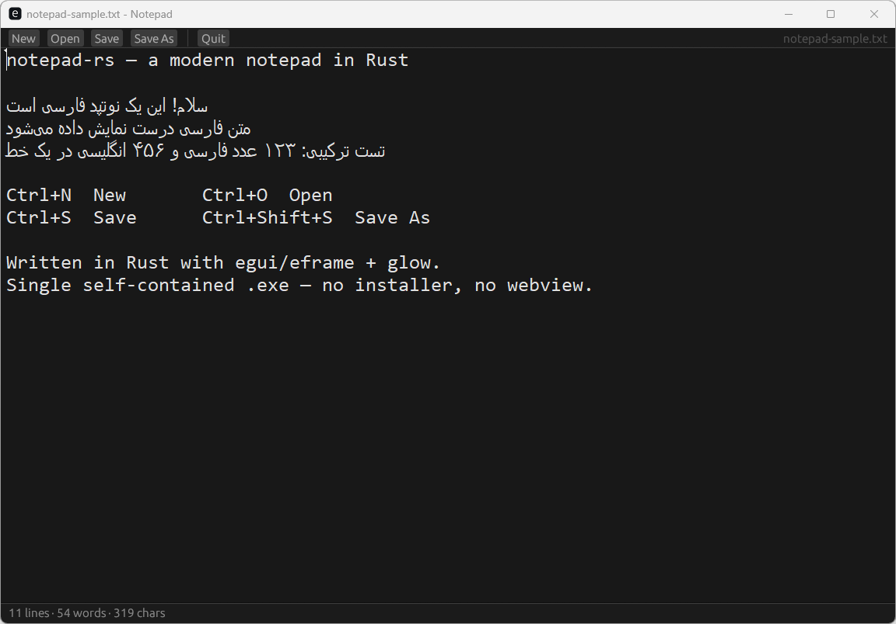

# notepad-rs

[](https://github.com/Nim4a/notepad-rs/actions/workflows/ci.yml)
[](https://github.com/Nim4a/notepad-rs/releases)
[](LICENSE)

A small, modern notepad for Windows written in Rust — [eframe](https://github.com/emilk/egui)/egui
for the chrome, the native Win32 `EDIT` control for the text area. No webview, no runtime deps.



## Why a native text control?

egui cannot shape or order RTL text: Persian/Arabic comes out with disconnected
letters and the wrong word order. The Windows `EDIT` control uses Uniscribe, so
letter joining, bidi, RTL paragraphs and the Persian IME come for free — and it
also gives us word wrap, undo/redo, selection and clipboard behaviour for free.

The chrome (toolbar, status bar) stays in egui and is themed dark; the editor
itself is a child window of the egui window, so it is positioned over the
central area every frame.

## Features

- Dark theme, monospace editor
- Open / Save / Save As with native Windows file dialogs
- `Ctrl+N` new · `Ctrl+O` open · `Ctrl+S` save · `Ctrl+Shift+S` save as
- Live line / word / character count
- Warns before closing with unsaved changes
- Persian/Arabic: correct letter joining, RTL paragraphs, mixed digits, IME
- Single self-contained `.exe`, no installer
- `notepad.exe path.txt` opens a file from the command line

## Download

Grab the latest `notepad.exe` from [Releases](https://github.com/Nim4a/notepad-rs/releases).

## Build from source

```bash
cargo build --release
# -> target/release/notepad.exe
```

Requires the `x86_64-pc-windows-gnu` target — no Visual Studio needed. On a
machine without MSVC, copy `.cargo/config.toml.example` to `.cargo/config.toml`
and fix the two paths.

egui is pinned to `0.31`: 0.35+ ships a new renderer (vello) that wedges the
OpenGL driver on older GPUs.

## Run

```bash
cargo run --release
```

## License

MIT — see [LICENSE](LICENSE).
